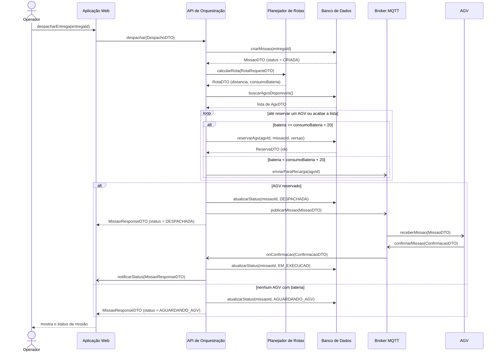
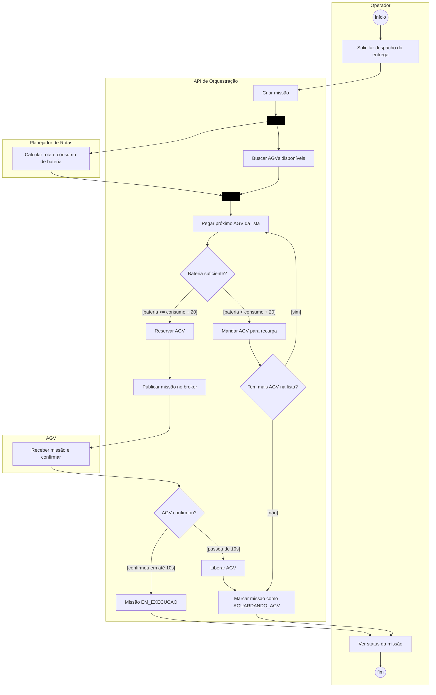
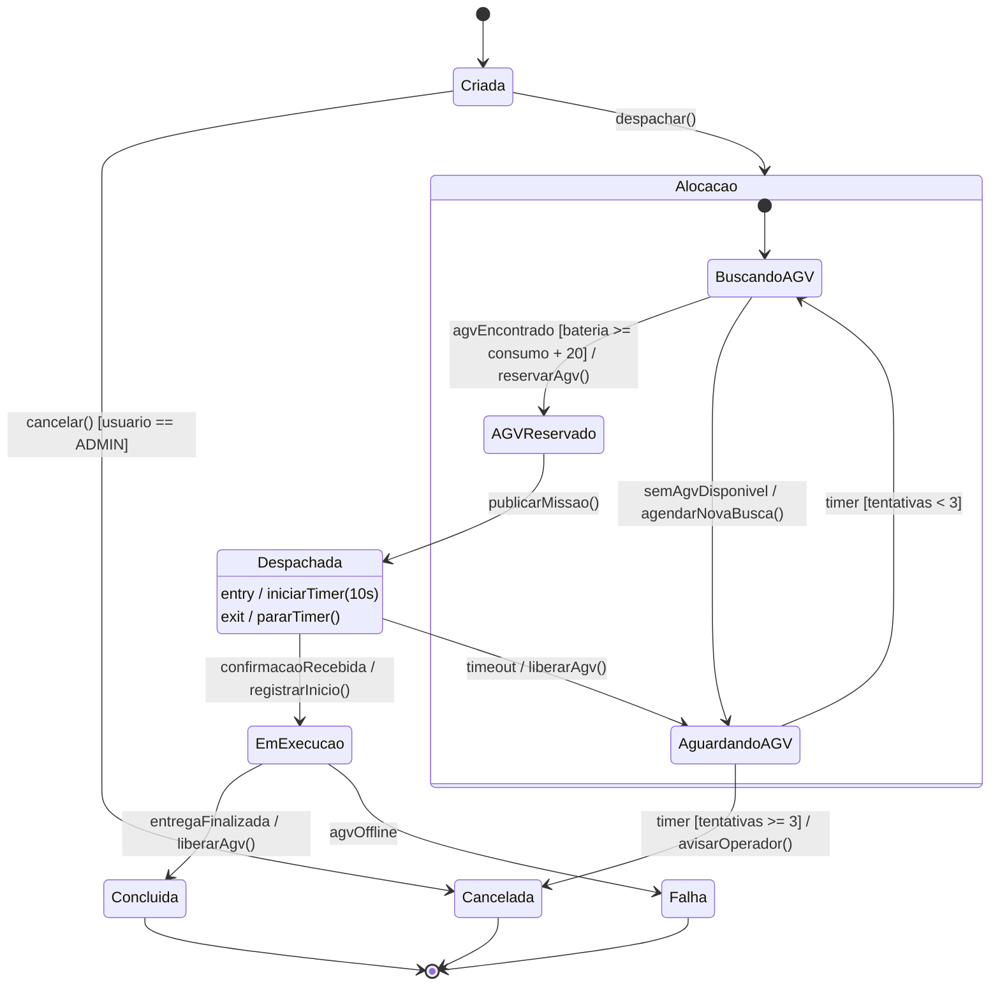
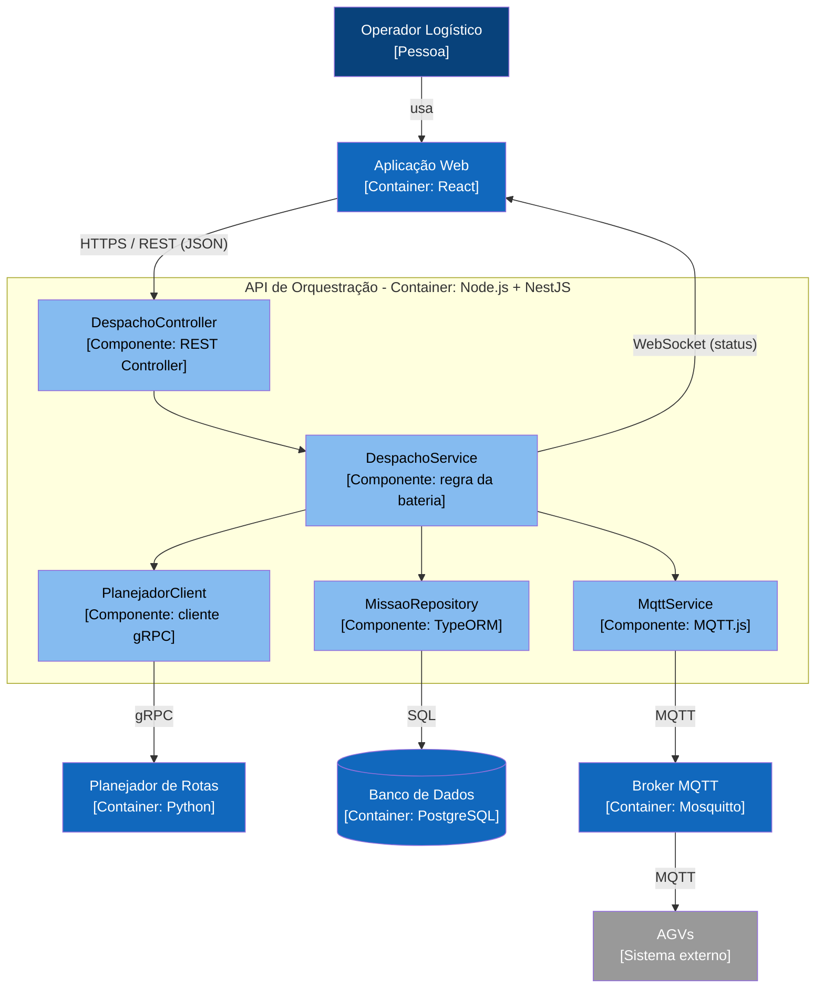

# APS 3 - Despacho de Missão com Checagem de Bateria

**Aluno:** Bladimir José Villarroel Guevara
**Disciplina:** Modelagem de Software - Prof. Sidney L. da Silva
**Projeto do grupo:** Sistema de Logística de Entregas Autônomas (AGVs)

## Sobre a funcionalidade

Escolhi o **despacho de missão**. É quando o operador pede para uma entrega ser feita e o sistema precisa escolher qual AGV vai fazer ela.

O ponto principal é a bateria: o AGV só pode receber a missão se a bateria dele for maior ou igual ao consumo estimado da rota + 20% de margem. Se não tiver bateria, ele é mandado para recarregar e o sistema tenta o próximo AGV. Se nenhum servir, a missão fica aguardando.

Depois que a missão é enviada, o AGV tem 10 segundos para confirmar. Se não confirmar, o AGV é liberado e a missão volta a aguardar.

Escolhi essa parte porque se ela der errado o AGV pode ficar sem bateria no meio do caminho ou dois AGVs podem ser mandados para a mesma entrega.

## Operações usadas no diagrama de sequência

Cada mensagem do diagrama de sequência é uma operação de quem recebe:

- **Aplicação Web:** `despacharEntrega(entregaId)`, `notificarStatus(MissaoResponseDTO)`
- **API de Orquestração:** `despachar(DespachoDTO)`, `onConfirmacao(ConfirmacaoDTO)`
- **Planejador de Rotas:** `calcularRota(RotaRequestDTO): RotaDTO`
- **Banco de Dados (repositório):** `criarMissao(entregaId)`, `buscarAgvsDisponiveis()`, `reservarAgv(agvId, missaoId, versao)`, `atualizarStatus(missaoId, status)`
- **Broker MQTT:** `publicarMissao(MissaoDTO)`, `enviarParaRecarga(agvId)`, `confirmarMissao(ConfirmacaoDTO)`
- **AGV:** `receberMissao(MissaoDTO)`

## 1. Diagrama de Sequência

`->>` é chamada síncrona, `-)` é mensagem assíncrona (pelo broker MQTT ou WebSocket) e `-->>` é retorno com DTO.

## 2. Diagrama de Atividades

Raias: Operador, API de Orquestração, Planejador de Rotas e AGV.

## 3. Diagrama de Estados (MissaoAGV)

Alguns cuidados para a missão não ficar em estado errado:
- uma missão em execução não pode ser cancelada direto, ela só termina como Concluída ou Falha;
- se a confirmação do AGV chegar depois do timeout, ela é ignorada porque a missão já voltou para AguardandoAGV;
- a reserva do AGV usa a coluna `versao` (ver ADR 0001).

## 4. C4 - Nível 3 (Componentes)

## 5. ADR

[ADR 0001 - Usar bloqueio otimista para reservar o AGV](docs/architecture/adr-0001.md)

## Ligação entre os diagramas

| Atividade | Sequência | Estado |
|---|---|---|
| Criar missão | `criarMissao()` | Criada |
| Calcular rota / buscar AGVs (fork) | `calcularRota()` e `buscarAgvsDisponiveis()` | Alocacao |
| Reservar AGV | `reservarAgv()` | BuscandoAGV → AGVReservado |
| Publicar missão | `publicarMissao()` | AGVReservado → Despachada |
| AGV confirmou | `onConfirmacao()` | Despachada → EmExecucao |
| Marcar AGUARDANDO_AGV | `atualizarStatus(AGUARDANDO_AGV)` | AguardandoAGV |
